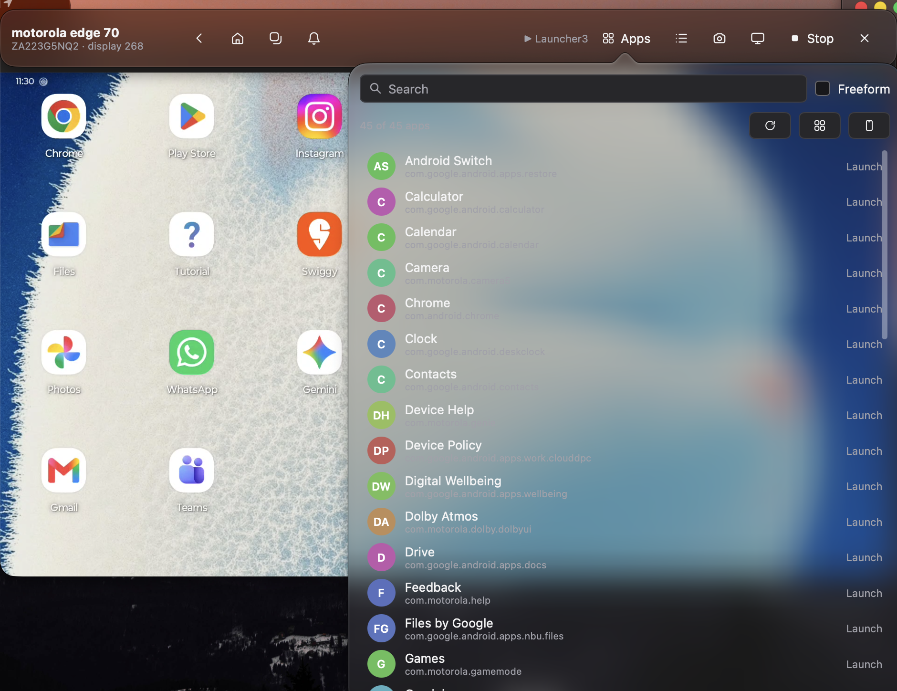
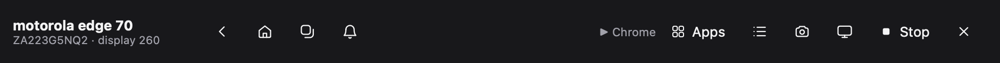
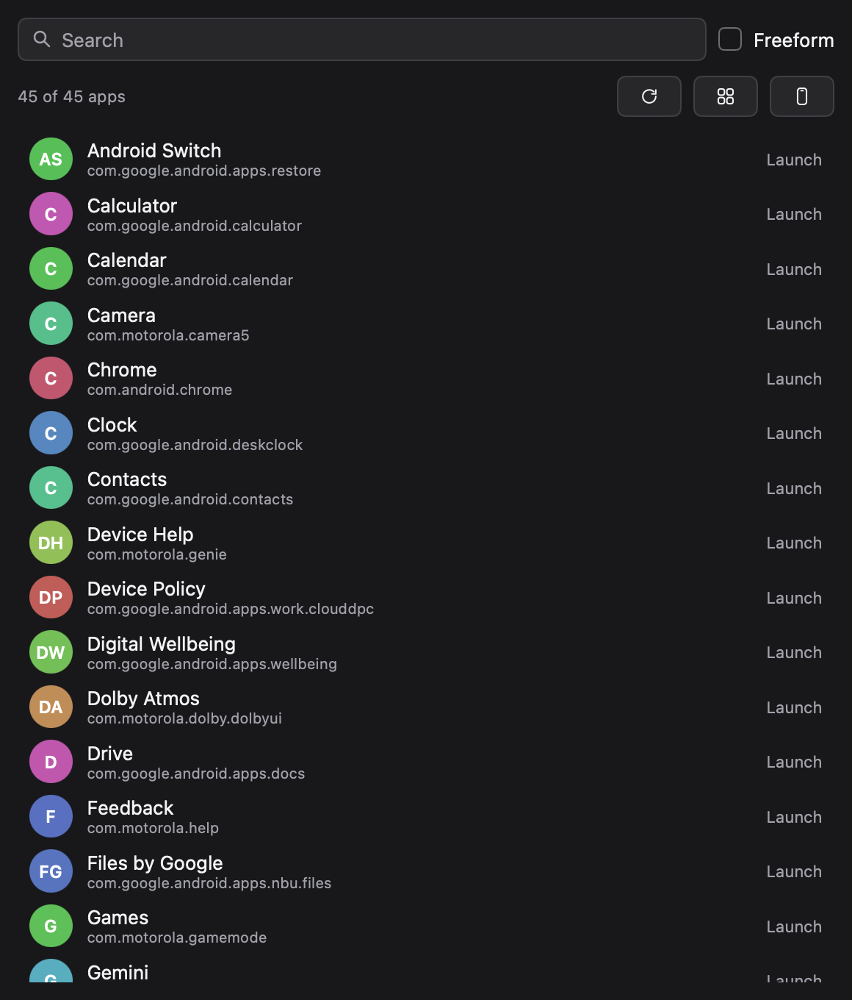
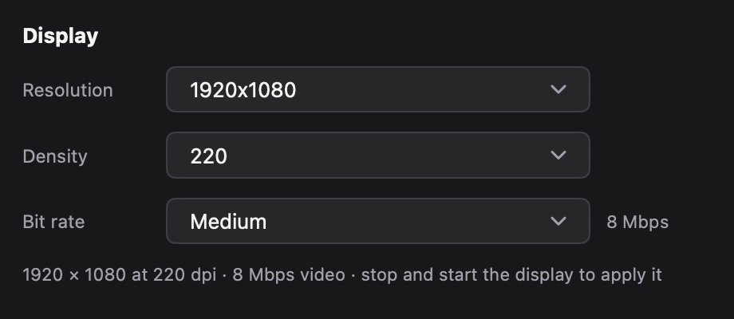

# Desk

A desktop mode for Android phones that don't have one, on your Mac.

Desk puts a control bar above a scrcpy window that shows a second, 1920×1080
display on your phone, and an app drawer under that bar. Apps you launch from
the drawer open on that display as resizable desktop windows. The phone keeps
working as a phone: this is a display *in addition* to its screen, not a
mirror of it.

It was written for a Motorola Edge 70, whose Ready For / Smart Connect desktop
mode cannot be started from a Mac (see the [notes at the root](../README.md)),
but nothing in it is Motorola-specific.



The bar and the drawer are panes of the system's material, where the desktop
has one: on macOS what is behind them shows through, blurred, as the system
draws its own bars and popovers. Where there is none, they are the theme's own
surfaces instead.

## Install

```sh
./build.sh              # Desk.app and Desk.dmg in build/
open build/darwin-arm64 # then drag Desk onto Applications from the .dmg
```

Or don't build it at all: the newest `Desk.dmg` is attached to the
[releases](../../releases/latest) — drag `Desk` onto Applications from that.

`build.sh` draws the icon, copies the `adb` and `scrcpy` it drives into the
bundle, and hands the whole thing to `mygo build`, which signs it and writes a
disk image whose window invites dragging `Desk.app` onto `Applications`. The
app is ad-hoc signed, so nothing else has to be installed on the Mac: no
scrcpy, no adb, no Go.

To install without the disk image:

```sh
./build.sh --install    # also copies Desk.app into /Applications
```

The `build.sh` at the root of the repository does this and the `desk` CLI
together, and takes the same flags (`make install`). This one is for the app on
its own, which is all it takes: the script's header comment is its manual.

Installing is also how the copy in `/Applications` is kept current, and it is
worth re-running rather than judging by eye: Go records the revision it built
from in the binary, so two builds of identical sources still differ once the
revision or the uncommitted-changes flag does. Ask the installed app which
commit it came from:

```sh
grep -ao 'vcs\.revision=[0-9a-f]*' /Applications/Desk.app/Contents/MacOS/Desk
```

Rebuild (`./build.sh --install`, or `make install` from the root) if that is not
the revision at the top of `git log`.

On the phone, once: **Settings → About phone → tap Build number seven times**,
then **Developer options → USB debugging** on, and plug it in. Accept the
"Allow USB debugging" prompt from your Mac.

macOS then asks for nothing else. (Screen Recording is only needed by the
development screenshots described below, not by the app.)

## Use

Press **Start**. Desk asks the phone for a virtual display, the phone's own
launcher appears on it, and scrcpy's window docks directly under the bar so the
two read as one. The bar's buttons all talk to that display:

| Button | What it does |
| --- | --- |
| ← | Back |
| ⌂ | Home |
| ▢ | Recent apps |
| 🔔 | Pull down the notification shade |
| Apps | The app drawer: every launchable app on the phone |
| Phone apps | The phone's *own* app list, opened on the display |
| Shot | Save a PNG of the display to `~/Pictures/Desk Shots` |
| Display | The resolution, density and video bit rate to ask the phone for |
| Start / Stop | Create or close the virtual display |
| ✕ | Quit, stopping the display first |



The middle of the bar is empty on purpose: drag it to move the bar, and the
display follows. A display that is stopped, or a phone that is unplugged, says
so in the bar instead of failing silently.

**The drawer** hangs under the *Apps* button. Type to filter the list, then
click an app to start it.



Three buttons beside the count go back to the phone itself: *Reload* re-reads
the app list, *Phone drawer* opens the phone's own app drawer, and *Phone home*
goes to its home screen. The bar has its own *Phone apps* button for that first
one, since it is the way back to the launcher the phone drew on the display.

The circle beside each app holds its initials, not its icon. An app's icon
would have to come out of the APKs on the phone, and that is not as simple as
it sounds: the file is not named predictably (Chrome's is not called
`ic_launcher` at all), it is usually an adaptive icon composed of two layers
that has to be combined and masked as the launcher does, and part of it can sit
in a Play `split` rather than the base APK. It is possible — by pulling the
manifest and resource table, which the phone's own `unzip` makes cheap — but it
is a lot of machinery for a list that reads perfectly well without it, so the
initials stay.

**The display** button chooses what the phone is asked for:



The resolution is the size of the virtual display, from a phone-sized
1280×720 up to 3840×2160. A resolution brings the **density** that keeps
Android's interface the same size on the screen — a 1080p phone draws it at
220 dpi — and the density can then be changed on its own, which makes
everything on the display bigger or smaller.

The **bit rate** is how much room scrcpy's video stream has, from *Low*
(4 Mbps) through *Crisp* (32 Mbps), with scrcpy's own default of *Medium*
(8 Mbps) in the middle. A desktop is much harder to compress than a phone
screen — it is full of small, sharp text on flat backgrounds, which is exactly
where a compressed picture shows its limits — so raising the bit rate is what
keeps the text looking like text. It costs nothing on the phone and nothing but
bandwidth on the Mac, and it is worth trying *Crisp* at 1080p.

All three apply the next time the display starts: *Stop* and *Start* to see the
change.

At the default 1920×1080 the display is a little wider than scrcpy's window,
so the video is close to pixel for pixel on a Retina screen and text is crisp.
Raise the resolution for more room to place windows; the picture gets smaller
to match.

**Freeform** (the checkbox) decides how apps open on the virtual display:

- **off** — full screen, one app at a time, as on the phone;
- **on** — as a resizable window, which is what makes the display feel like a
  desktop. Drag windows by their title bar, resize from the corners.

The display is not mirrored anywhere: scrcpy's window *is* your view of it, so
everything scrcpy knows still works there — <kbd>⌘</kbd><kbd>H</kbd> for Home,
<kbd>⌘</kbd><kbd>B</kbd> for Back, <kbd>⌘</kbd><kbd>O</kbd> to turn the phone's
screen off, <kbd>⌘</kbd><kbd>↑</kbd>/<kbd>↓</kbd> to change the volume, and
<kbd>⌘</kbd><kbd>Q</kbd> to stop.

Closing the bar quits, and stops the display with it. Nothing is left running
on the phone: the display is a virtual one, and the apps on it are not
interrupted — with `--no-vd-destroy-content`, they move back to the phone.

## How it works

scrcpy's `--new-display` creates a virtual display owned by the scrcpy server,
so no app has to be installed on the phone. Android starts the phone's
secondary-display launcher on it by itself. Desk then adds what that display
lacks:

- **Navigation.** The virtual display has no navigation bar — it exists, and is
  blank. The bar's four navigation buttons send the corresponding key codes to
  the display instead.
- **Apps.** `scrcpy --list-apps` gives the launchable apps and their friendly
  names; launching one is `am start --display <id> --windowingMode 5`.
- **Windowing.** Freeform is 5: `am start` parses `--windowingMode` as an
  integer and rejects the word "freeform".

A few details are load-bearing and are commented where they live in
[`deskctl.go`](deskctl.go): the *logical* display id comes from scrcpy's log
and is what input and `am start` need, while screenshots need the *physical*
id from `dumpsys SurfaceFlinger`, because `screencap -d` refuses a logical id
for a display owned by another process.

## Developing

```sh
go test ./...                            # the views run headless
DESK_IT=1 go test -run TestDeviceIntegration -v   # drives the real phone
```

The layout is checked without a screen by rendering the windows to PNGs, which
is how the *bar*, *drawer* and *display* pictures above were made:

```sh
go run . -capture bar.png -capture-drawer drawer.png -capture-display display.png
```

Each window renders, is written, and the app exits. What is rendered is what
the views paint: the material a window is a pane of is drawn *behind* it by the
system, so a capture has none, and the views paint their own surfaces in it
instead — which is also what they do on a desktop that has no material.

The picture at the top is a real screenshot of the app on the desktop, so it
shows the material; it was taken with macOS's Screen Recording permission.

`-auto-start` starts the display as soon as the phone is found, which is handy
from a launcher.

Two more commands are useful while working on it:

```sh
go tool mygo vet .               # vet, and check native UI build lifetimes
go run ./cmd/mkicon -o resources/icon.png   # redraw the icon
```

## Troubleshooting

**"no device connected"** — `adb devices` while the app is closed. It must list
the phone as `device`, not `unauthorized`: unplug and replug, and accept the
prompt on the phone. Enable *USB debugging* again if the phone was rebooted.

**"adb not found"** — the app looks for `adb` and `scrcpy` in
`Desk.app/Contents/Resources/bin`, then a `bin` directory beside the
executable, then `~/Downloads/scrcpy-macos-*`, then `PATH`. Set
`DESK_SCRCPY_DIR=/path/to/scrcpy` to point it somewhere else.

**macOS refuses to open the app** — that is Gatekeeper on an ad-hoc signed
build that arrived with a quarantine flag. Right-click the app and choose
*Open* once, or:

```sh
xattr -dr com.apple.quarantine /Applications/Desk.app
```

**The display appears but apps open full screen** — check *Freeform* in the
drawer. Without it, the display is a phone screen on a bigger canvas.

**Chrome, and a few other apps, draw a black window** — some apps refuse to
render on a virtual display. YouTube and Chrome are known to exit or show
black; the phone's own launcher, Settings, Files, Photos, and the Google apps
in general are fine.

The [notes at the root](../README.md) list the dead ends that led here: Ready
For's signature-protected permission, Motorola's disabled desktop components,
and why macOS cannot be a Miracast sink.

Desk is free software under the [GPL-3.0](../LICENSE): use it, change it, pass it
on — and whatever you build from it stays free too.
